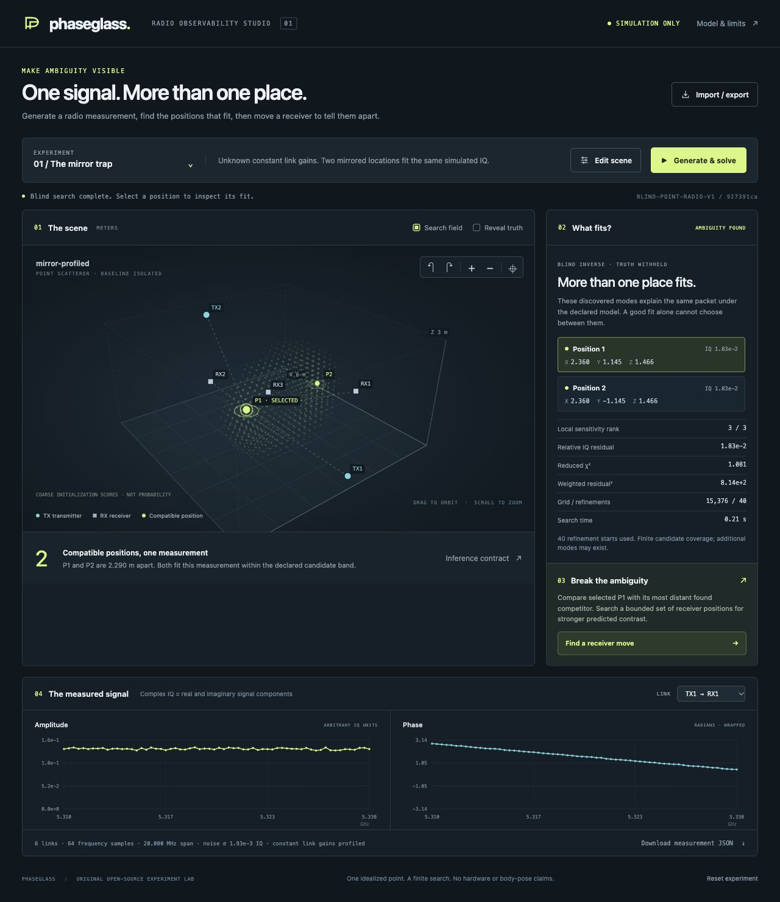

# Phaseglass

**One signal. More than one place.**

Phaseglass is a radio observability studio: generate a complex radio signal,
reconstruct the locations that can explain it, then design a receiver move that
separates competing explanations. It makes inverse problems tangible: orbit the
3D scene, inspect actual IQ, change the experiment, and rerun the inference.

**Simulation only.** No hardware, neural checkpoint, account, cloud or paid API.
This release models one idealized point scatterer, not a human body or room scan.



## Try the mirror trap

```sh
git clone https://github.com/nazeeh111/Phaseglass.git
cd Phaseglass
python3 -m venv .venv
source .venv/bin/activate
python -m pip install .
phaseglass studio
```

Open **http://127.0.0.1:6365/**. Python 3.10+; Windows activation is
`.venv\Scripts\activate`. NumPy and SciPy are the only runtime dependencies.
Alternatively download the wheel from [Releases](https://github.com/nazeeh111/Phaseglass/releases).

1. The initial experiment returns two compatible positions with truth hidden.
2. Choose **Find a receiver move**. The placement search compares their predicted
   signals after allowing an unknown constant complex gain on each link.
3. Apply the move. Phaseglass changes one receiver, generates a **new** packet,
   and solves again. The old measured IQ is never rewritten.
4. Reveal simulated truth, then try **A convincing wrong answer**: an undeclared
   phase slope can produce an excellent fit several meters from the generator.

## What you can do

- **Design a real mathematical experiment.** Edit antennas, room bounds, point,
  frequency band, noise and calibration. Add an extra reflector or a counterfeit
  phase slope to challenge the inverse model.
- **Inspect the evidence.** Actual complex IQ plots, a finite coarse residual
  field, found modes, numerical sensitivity, optimizer status and mismatch gates.
- **See why more data may be necessary.** Twelve reproducible examples include
  exact mirrors, receiver loss, one tone, narrow/noisy bands, off-grid points and
  model violations. None uses precomputed inferred positions.
- **Solve a signal without its generator.** Import a strictly typed measurement
  JSON; the inverse rejects extra truth, seed and pose fields. Imported IQ has no
  assumed generator and cannot be silently “regenerated.”
- **Take the experiment with you.** Export original solver source, measurements,
  recomputed results, dependency requirements, license and SHA256 manifest in a
  ZIP. Truth is separate and opt-in. Rerun from any working directory.

## Blind CLI

```sh
phaseglass solve examples/measurements/mirror-profiled.json --output fit.json
phaseglass intervention examples/measurements/mirror-profiled.json --result fit.json --output move.json
phaseglass export examples/measurements/mirror-profiled.json --output experiment.zip
# Extract the ZIP into a fresh directory, install its requirements, then:
python rerun.py --output independently-rerun.json
```

`phaseglass simulate scene.json` emits `{measurement, truth}` with the two kept
separate. `solve` takes the measurement object alone. Outputs never overwrite an
existing file. [Measurement schema](docs/MEASUREMENTS.md) and
[model/search contract](docs/MODEL.md) explain custom input and its limits.

## Mechanism, not a skeleton animation

For each transmitter/receiver pair and frequency, the forward model is

```text
H(f,p) = exp(-i·2π·f·(distance(TX,p)+distance(p,RX))/c)
         / (distance(TX,p)·distance(p,RX))
```

The inverse receives geometry, frequencies and measured IQ. It evaluates a finite
3D grid, refines at most 40 starts with bounded least squares, retains competing
fits and computes a local numerical Jacobian. “Profiled” gains are nuisance
parameters fitted analytically per link. The placement search tests 225 receiver
sites for separation of a chosen pair, including the same nuisance gains.

The coarse field is the actual **unweighted profiled squared residual**, including
in calibrated mode. Its visual intensity is not a probability or a calibrated
fit. A locally full-rank fit can coexist with a distant mirror solution.

## Evidence and limits

The tests exercise independent scalar geometry and complex arithmetic, separate
blind subprocess reruns, adversarial model counterexamples, actual HTTP requests,
input bounds, cancellation and exported source. To reproduce:

```sh
python -m unittest discover -s tests -v
python tools/replay_evidence.py --output evidence.json
```

The independent evaluator reads generator truth **after** blind fits exist. It
reports errors to assess the simulation; it never selects a fit using truth.
[Recorded release evidence](docs/evidence.json) records the actual outcomes.

This is a finite search, not a global uniqueness certificate. Acceptance bands,
chi-squared refusal and weak-direction holds are declared diagnostics, not
calibrated uncertainty coverage. A refusal may also indicate search failure.
Unknown hardware phase slopes can counterfeit a good fit. `c/B` is a total-path
delay scale, not generic spatial resolution or a centimeter sensing claim.

No direct path, wall, diffraction, polarization, motion, body surface or live CSI
capture is modeled. Hardware data needs baseline isolation, calibrated geometry,
frequency mapping and a better validated forward model before meaningful use.
All included data is locally simulated, in arbitrary IQ units.

## Built to inspect and share

The local server exposes fixed operations on loopback only, validates host/origin,
limits JSON to 2 MiB and 32 nesting levels, admits two workers and 16 connections,
and stops workers after 25 seconds or an observed client disconnect. Search is
bounded to 20,000 grid positions and 8,000,000 link-frequency-position evaluations.
No arbitrary command, local-file path or telemetry endpoint is accepted.

MIT for the original application. [Dependency notices](THIRD_PARTY_NOTICES.md).
Developed with Codex assistance. Contributions that improve numerical reliability,
model transparency or reproducible radio experiments are welcome. If it helps
you explain an inverse problem, a star helps others find it.
