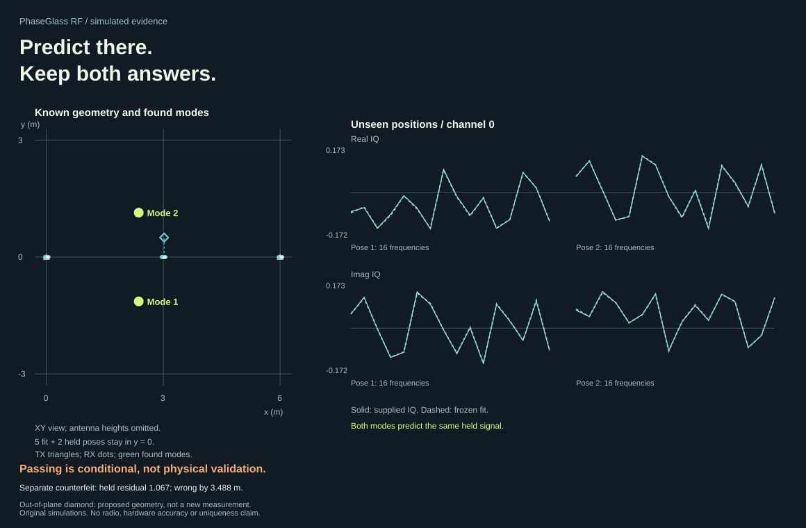
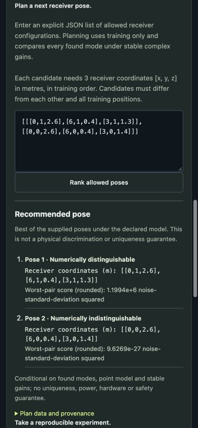
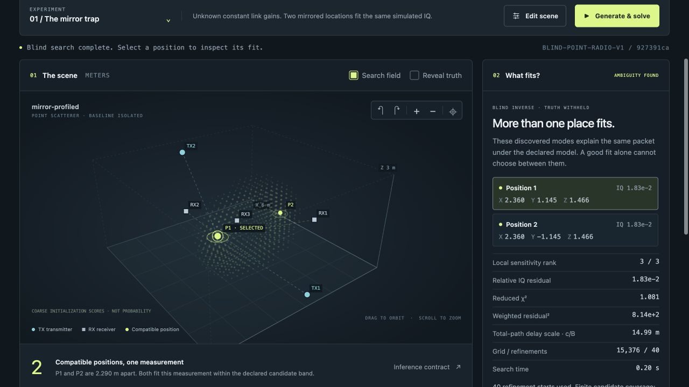
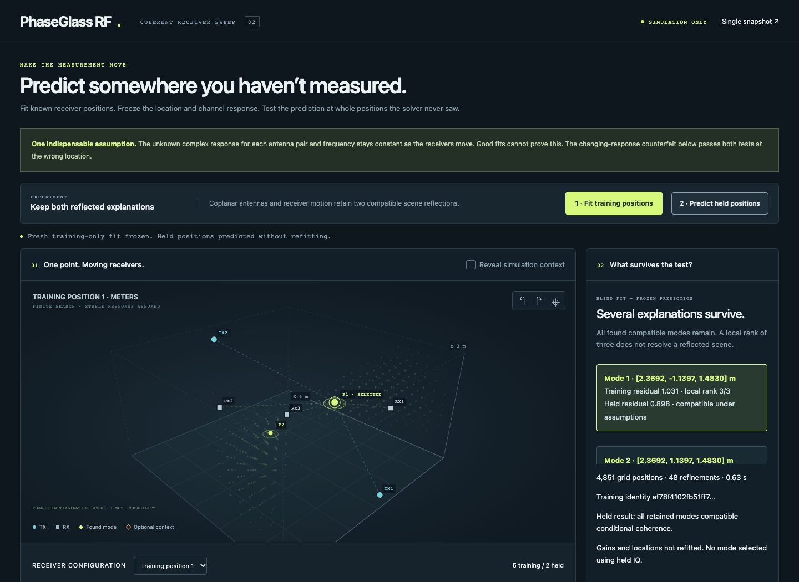

# PhaseGlass RF

**Fit a radio signal. Move the receiver. Keep the explanations that survive.** PhaseGlass RF makes complex-signal inference inspectable: known antenna geometry, competing point locations, frozen channel responses and prediction at positions excluded from fitting.

In the worked coplanar sweep, **two reflected locations predict the same unseen signals**. A proposed out-of-plane receiver move could distinguish them under the model. A separate changing-response counterfeit passes held prediction while **3.488 m from its simulated generator**. Passing a check does not prove the hardware-response assumption.

<picture><source media="(max-width: 600px)" srcset="docs/presentation/sweep-mobile.svg"></picture>

[Follow the worked experiment](docs/presentation/README.md) · [Download its native portable replay](docs/presentation/ui-experiment.zip) · [Explore three recorded experiments](https://nazeeh111.github.io/Caustryn/demo/) · [Install the local Studio](#install-and-run)

**Simulation only.** One idealized point scatterer, not a human body or room scan. No radio hardware, neural checkpoint, account, cloud or paid API. PhaseGlass RF is the current display name; **Caustryn URLs and the compatible `phaseglass` package remain unchanged**. [Historical release downloads](https://github.com/nazeeh111/Caustryn/releases).

## Fit here, predict there

[Explore the three recorded experiments in your browser](https://nazeeh111.github.io/Caustryn/demo/), then open **http://127.0.0.1:6365/sweep.html** after the installation below for new calculations. The public replay is read-only; the local workshop fits your inputs. A coherent
receiver sweep uses known antenna positions to profile a separate unknown complex
response for every antenna pair and frequency. Fit five positions, then predict
two entire withheld configurations with the location and gains frozen.

- **Break a stable phase-slope counterfeit.** A single snapshot fits the wrong
  simulated point; known receiver motion distinguishes it.
- **Keep both reflections.** Coplanar geometry retains two modes, each with its
  own unchanged held-position prediction.
- **A wrong scene can still pass.** [Open the exact-counterfeit
  case](https://nazeeh111.github.io/Caustryn/demo/?case=exact-counterfeit).
  Deliberately changing the response can counterfeit another location and pass
  both checks. Reveal synthetic truth in the viewer to see the distance. Stable
  hardware response remains a trusted assumption, not a conclusion from residuals.
- **Change the packets and take the proof.** Strict training/held editors,
  stale-result guards, cancellation, actual IQ prediction plots, optional
  separate simulation context, and source-bearing portable reruns.

[Coherent measurement contract and prior art](docs/COHERENT.md).
All nine new cases are original simulations with exact supplied geometry. Their
small positive errors are not physical precision or a hardware benchmark.



The training-only ranking compares two supplied configurations against the retained mirror modes. The score is conditional on the point model and stable gains; it is not physical validation.



Both images are actual local synthetic calculations in the current interface. Historical release assets, the `phaseglass` Python package and data formats retain their original names for compatibility. Both console commands remain available. [Product verification](docs/product-verification.md).

## The actual local sweep



[Phone view](docs/presentation/workbench-mobile.png) · [Raw calculation](docs/presentation/mirror.result.json) · [Earlier recorded presentation](docs/presentation/README.md#preserve-the-model-and-historical-context)

## Install and run

```sh
git clone https://github.com/nazeeh111/Caustryn.git
cd Caustryn
python3 -m venv .venv
source .venv/bin/activate
python -m pip install -r requirements.lock .
caustryn studio
```

Open **http://127.0.0.1:6365/**. Python 3.12+; Windows activation is
`.venv\Scripts\activate`. NumPy and SciPy are the only runtime dependencies. Version 0.2 requires Python 3.12+; the older 0.1 release retains its Python 3.10 support.
Use `caustryn` for new work. The existing `phaseglass` command calls the
same implementation, so existing scripts and portable experiments continue to work.
The Python distribution and imports remain `phaseglass`. The historical 0.2.1 release predates the finite next-pose planner in this development source. Download published wheels from [Releases](https://github.com/nazeeh111/Caustryn/releases).

1. The initial experiment returns two compatible positions with truth hidden.
2. Choose **Find a receiver move**. The placement search compares their predicted
   signals after allowing an unknown constant complex gain on each link.
3. Apply the move. PhaseGlass changes one receiver, generates a **new** packet,
   and solves again. The old measured IQ is never rewritten.
4. Reveal simulated truth, then try **A convincing wrong answer**: an undeclared
   phase slope can produce an excellent fit several meters from the generator.

## What you can do

- **Design a real mathematical experiment.** Edit antennas, room bounds, point,
  frequency band, noise and calibration. Add an extra reflector or a counterfeit
  phase slope to challenge the inverse model.
- **Inspect the evidence.** Actual complex IQ plots, a finite coarse residual
  field, found modes, numerical sensitivity, optimizer status and mismatch gates.
- **See why more data may be necessary.** Twelve reproducible examples include
  exact mirrors, receiver loss, one tone, narrow/noisy bands, off-grid points and
  model violations. None uses precomputed inferred positions.
- **Solve a signal without its generator.** Import a strictly typed measurement
  JSON; the inverse rejects extra truth, seed and pose fields. Imported IQ has no
  assumed generator and cannot be silently “regenerated.”
- **Take the experiment with you.** Export original solver source, measurements,
  recomputed results, dependency requirements, license and SHA256 manifest in a
  ZIP. Truth is separate and opt-in. Rerun from any working directory.

## Blind CLI

```sh
caustryn solve examples/measurements/mirror-profiled.json --output fit.json
caustryn intervention examples/measurements/mirror-profiled.json --result fit.json --output move.json
caustryn export examples/measurements/mirror-profiled.json --output experiment.zip
# Extract the ZIP into a fresh directory, install its requirements, then:
python rerun.py --output independently-rerun.json
```

Coherent training and held observations remain independent inputs:

```sh
caustryn sweep-solve examples/coherent/slope-counterfeit.training.json --output training-fit.json
caustryn sweep-evaluate examples/coherent/slope-counterfeit.training.json --validation examples/coherent/slope-counterfeit.validation.json --output held-prediction.json
caustryn sweep-export examples/coherent/slope-counterfeit.training.json --validation examples/coherent/slope-counterfeit.validation.json --output coherent-experiment.zip
# Extract into a new folder; install requirements.lock, then run:
python rerun.py --output independently-predicted.json
```

`caustryn simulate scene.json` emits `{measurement, truth}` with the two kept
separate. `solve` takes the measurement object alone. Outputs never overwrite an
existing file. Files are staged beside the destination and published only after
writing completes, using a create-only hard link. The filesystem must support
hard links. A crash can leave a temporary `.phaseglass-` file; an error after
publication can leave a complete destination file. This is not a power-loss
durability guarantee. [Measurement schema](docs/MEASUREMENTS.md) and
[model/search contract](docs/MODEL.md) explain custom input and its limits.

## Mechanism, not a skeleton animation

For each transmitter/receiver pair and frequency, the forward model is

```text
H(f,p) = exp(-i·2π·f·(distance(TX,p)+distance(p,RX))/c)
         / (distance(TX,p)·distance(p,RX))
```

The inverse receives geometry, frequencies and measured IQ. It evaluates a finite
3D grid, refines at most 40 starts with bounded least squares, retains competing
fits and computes a local numerical Jacobian. “Profiled” gains are nuisance
parameters fitted analytically per link. The placement search tests 225 receiver
sites for separation of a chosen pair, including the same nuisance gains.

The coarse field is the actual **unweighted profiled squared residual**, including
in calibrated mode. Its visual intensity is not a probability or a calibrated
fit. A locally full-rank fit can coexist with a distant mirror solution.

## Evidence and limits

The tests exercise independent scalar geometry and complex arithmetic, separate
blind subprocess reruns, adversarial model counterexamples, actual HTTP requests,
input bounds, cancellation and exported source. To reproduce:

Install the pinned development test runner, then run both test styles and the
browser-control checks from the source checkout:

```sh
python -m pip install 'pytest==9.2.0'
python -m unittest discover -s tests -v
python -m pytest -q
node tests/studio-inputs.mjs studio/app.js
node tests/sweep-controls.mjs studio/sweep.js
node tests/plan-presentation.mjs studio/sweep.js
node tests/sweep-plot.mjs studio/sweep.js
python tools/replay_evidence.py --output evidence.json
```

The independent evaluator reads generator truth **after** blind fits exist. It
reports errors to assess the simulation; it never selects a fit using truth.
[Recorded release evidence](docs/evidence.json) records the actual outcomes.

This is a finite search, not a global uniqueness certificate. Acceptance bands,
chi-squared refusal and weak-direction holds are declared diagnostics, not
calibrated uncertainty coverage. A refusal may also indicate search failure.
Unknown hardware phase slopes can counterfeit a good fit. `c/B` is a total-path
delay scale, not generic spatial resolution or a centimeter sensing claim.

No direct path, wall, diffraction, polarization, motion, body surface or live CSI
capture is modeled. Hardware data needs baseline isolation, calibrated geometry,
frequency mapping and a better validated forward model before meaningful use.
All included data is locally simulated, in arbitrary IQ units.

## Built to inspect and share

The local server exposes fixed operations on loopback only, validates host/origin,
limits JSON to 2 MiB and 32 nesting levels, admits two workers and 16 connections,
and stops workers after 25 seconds or an observed client disconnect. Search is
bounded to 20,000 grid positions and 8,000,000 coarse link-frequency-position evaluations.
No arbitrary command, local-file path or telemetry endpoint is accepted.

MIT for the original application. [License and dependency terms](LICENSE).
Contributions that improve numerical reliability,
model transparency or reproducible radio experiments are welcome.

### Plan a coherent next receiver configuration

Supply a JSON array of 1–64 distinct allowed configurations, each a list of receiver
coordinates in metres with the same receiver order as training. Then run:

```sh
phaseglass sweep-plan examples/coherent/mirror.training.json --allowed-poses allowed-poses.json
phaseglass sweep-export examples/coherent/mirror.training.json --allowed-poses allowed-poses.json --output sweep.zip
```

The planner solves training afresh and reports its hash and the hash of the exact fit.
It maximizes the worst pair's smaller directed increase in profiled squared residual,
allowing a separate complex gain per pair and frequency to adjust across training
and proposed positions. Scores are conditional predictions, not probabilities or
power. Numerical no-separation is judged against a floating-point tolerance relative
to the two modeled amplitudes, while the reported score remains in physical IQ units
(or noise-normalized units). The ranking lists numerically distinguishable poses first,
then orders each group by raw score. It recommends the highest-scoring distinguishable
pose and reports no separation only when none pass the numerical gate. It refuses
weak, mismatched, rank-deficient, and single-mode fits; a single
found mode is not a uniqueness certificate. The finite allowed list is supplied by
the user and is not checked for physical feasibility. Held observations do not enter
planning. The portable ZIP includes the list and fresh plan and can recompute it
with `python rerun.py --plan` under its documented dependency lock.
