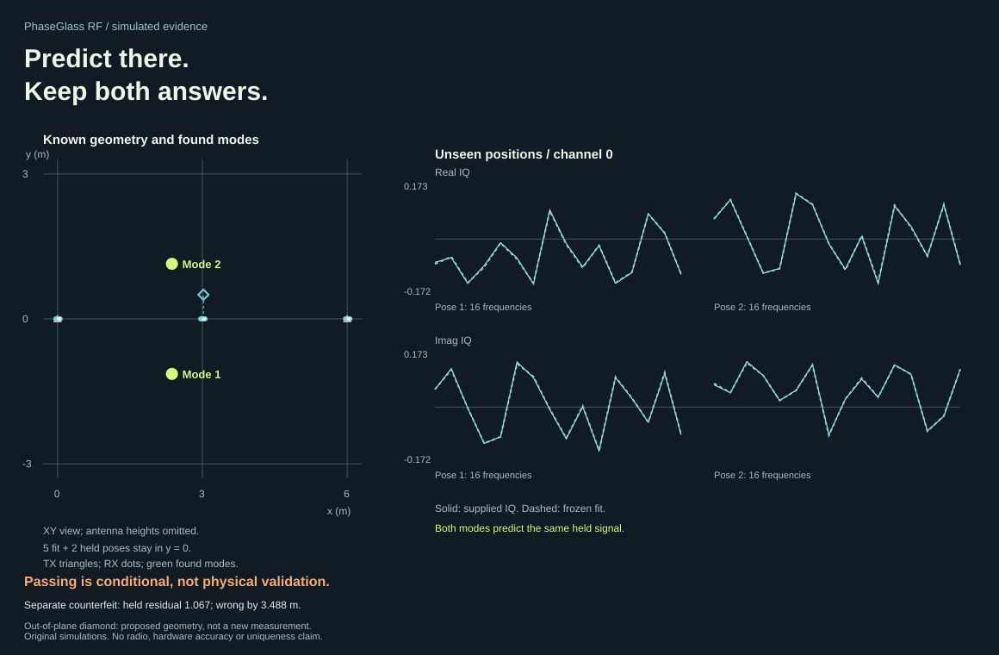

# Predict elsewhere. Keep both explanations.

This is a new execution of three existing, original PhaseGlass RF simulations under current public main. No radio signal was transmitted or captured. The data model is one idealized stationary point, exactly supplied antenna positions and a response constant across receiver motion. Good residuals do not establish those assumptions.

## The completed mirror experiment

The `mirror` packet supplies two transmitters, three receivers, sixteen frequencies and five training receiver configurations. Fit training, freeze each found location and its complex gain for every pair/frequency, then predict two **whole withheld configurations**. No held IQ enters the fit, refits a gain or location, or selects/removes a mode.

Two reflected modes survive:

- Mode 1: `[2.3692209209, −1.1397023497, 1.4829684143]` metres.
- Mode 2: `[2.3692209209, +1.1397023497, 1.4829684143]` metres.

Both return exactly the same held complex predictions and reduced residual **0.8979225342**. Coplanar motion in `y = 0` preserves this reflection. Local Jacobian rank three does not remove the distant alternative. These are finite-search found modes, not an exhaustive uniqueness certificate.

<picture><source media="(max-width: 600px)" srcset="sweep-mobile.svg"></picture>

The geometry shows every supplied training and held receiver coordinate, both transmitters and found modes, on equal x/y scales in metres. Antenna heights are explicitly omitted in this XY projection. Closely spaced receiver coordinates overlap at this scale; they are retained rather than spread artificially. The signal panels contain all 32 real and 32 imaginary samples of channel zero, plus their frozen prediction, with a gap between configurations. The other five channels remain in the records. No smoothing or interpolation adds samples. Both components share one amplitude scale, in arbitrary IQ units.

## Propose a move without fabricating a measurement

The existing training-only planner compares exactly two supplied allowed receiver configurations. Keeping receiver 3 in the plane has worst-pair score approximately **8.85 × 10⁻²⁷**, below the numerical separation gate. Moving receiver 3 to `y = 0.5 m` while retaining the other specified coordinates produces score **157059.517493**, in noise-standard-deviation-squared units, and is recommended under the point/stable-response model. The scores allow nuisance gains to adjust for the compared models. They are conditional separation calculations, not power, probabilities, physical feasibility or acquired observations. No held IQ enters planning.

[Exact allowed coordinates](allowed-poses.json) · [Native plan](plan.json). The cyan diamond is that proposed receiver position, not a newly measured packet.

## A passing prediction can still be wrong

The independent `exact-counterfeit` simulation deliberately varies response with pose to impersonate another location. Training finds `[4.4260252497, −1.6149099013, 0.8725954228] m`; its held reduced residual **1.0671951691** passes the declared heuristic, while the point is **3.4883707701 m** from the separately disclosed generator truth. This is an intentional counterexample, not physical localization accuracy or an ordinary-scene failure rate.

The stable-slope control finds a location about **0.0004664 m** from its generator and held residual **0.8802793321**. That small error is for a matched idealized simulation with supplied geometry, not hardware precision. Neither case validates the trusted response model. Truth is consulted only after the blind result exists.

## Run, change, save and reopen

Use the repository's [installation](../../README.md#install-and-run), then open `http://127.0.0.1:6365/sweep.html`. Choose **Keep both reflected explanations**, fit training and predict held positions. Orbit with arrow keys and zoom with plus/minus; candidate coordinates are also text. Save training JSON or download the native portable sweep.

Under **Edit or import the experiment**, paste the separate training and held packets. Editing invalidates stale results. Apply validates the pair before a new fit; **Bind held packet** changes an identity hash, not observations or scientific provenance. Invalid drafts remain available for correction. Cancel blocks late results and retains the current packets. A fresh phone browser imported these exact packets and reproduced the two-mode prediction.

```sh
caustryn sweep-evaluate mirror.training.json --validation mirror.validation.json --output NEW-result.json
```

[Download the actual UI-produced portable experiment](ui-experiment.zip), or the [CLI-produced equivalent](mirror-experiment.zip). Each is a native, self-contained 22-member producer export with its own archive-specific README, exact NumPy/SciPy lock, original source, separate packets, manifest, result and `rerun.py`. Extract to a new directory and run its `rerun.py` from any working directory under that lock. No outer wrapper or copied repository guide is needed. Both archives freshly replayed with all numerical fields exact; elapsed `seconds` legitimately differs. Existing output names are refused and their bytes retained.

## Inspect the evidence

[Mirror training](mirror.training.json) · [held packet](mirror.validation.json) · [blind fit and held predictions](mirror.result.json) · [separate generator context](mirror.truth.json).

[Counterfeit result](exact-counterfeit.result.json) · [counterfeit truth](exact-counterfeit.truth.json) · [stable-slope control](slope-counterfeit.result.json) · [control truth](slope-counterfeit.truth.json).

[Figure inputs](figure-data.json) · [renderer](figure.py) · [actual desktop](workbench-desktop.png) · [actual 375-pixel phone](workbench-mobile.png) · [browser checks](browser.json).

## Preserve the model and historical context

Read the full [coherent contract and prior art](../COHERENT.md), [point model](../MODEL.md), [measurement schema](../MEASUREMENTS.md), [recorded research evidence](../evidence.json) and [product verification](../product-verification.md). Existing [public recorded experiments](https://nazeeh111.github.io/Caustryn/demo/), [earlier desktop presentation](../presentation-desktop.png), [phone presentation](../presentation-phone.png), [single-snapshot studio](../studio.png) and [coherent studio](../coherent-studio.png) remain available.

PhaseGlass RF is the display identity; the repository remains Caustryn, the import/distribution is `phaseglass`, and both `caustryn` and `phaseglass` console commands remain compatible. Original code and simulations retain their MIT notice and authorship in [LICENSE](../../LICENSE). NumPy/SciPy retain their separately installed BSD/dependency notices. No third-party empirical RF measurements, neural checkpoint or physical claim is added. No renamed repository or held engineering patch is included.
